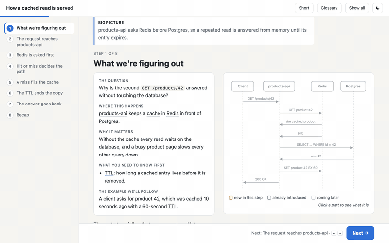

# explain-interactive

A Claude Code skill that turns an explanation you found hard to follow into a
self-contained, step-by-step interactive HTML page. Each page follows one running
example through a single shared diagram, highlights the part each step is about, and
adds a glossary, a recap and short quizzes.

## Use

Ask for it after an explanation, e.g. "show me that as HTML", "walk me through it step
by step", or run `/explain-interactive <topic>`. The page is written to
`~/explanations/<topic>.html` (with its source, `<topic>.content.js`, next to it) and opened in your browser. Nothing is published.

## Install

In Claude Code:

    /plugin install explain-interactive --marketplace sergicastro/skills

On Claude Code older than 2.1.275, add the marketplace first:

    /plugin marketplace add sergicastro/skills
    /plugin install explain-interactive@sergicastro-skills

## Layout

- `skills/explain-interactive/SKILL.md`: the workflow and the data format for each step
- `skills/explain-interactive/engine/`: the page shell, styles and script shared by every page (`page.html`, `engine.css`, `engine.js`)
- `skills/explain-interactive/build.mjs`: inlines a content file into the engine and writes one offline HTML file (Node 22+, no dependencies)
- `skills/explain-interactive/examples/`: a sample content file
- `test/`: `node --test plugins/explain-interactive/test/*.test.mjs` (the browser test needs Chrome or Chromium; set `CHROME=` to pick one)

Claude writes only `~/explanations/<topic>.content.js` (`META`, `CAST`, `GLOSSARY`, `DIAGRAM`, `STEPS`); the build turns it into the page. To change a page, edit its content file and rebuild:

    node skills/explain-interactive/build.mjs ~/explanations/<topic>.content.js

Pages made before the engine split can be recovered with `build.mjs --extract <page>.html`.
- `skills/explain-interactive/diagram-recipes.md`: patterns for the shared diagram

## License

MIT. See [LICENSE](../../LICENSE).
