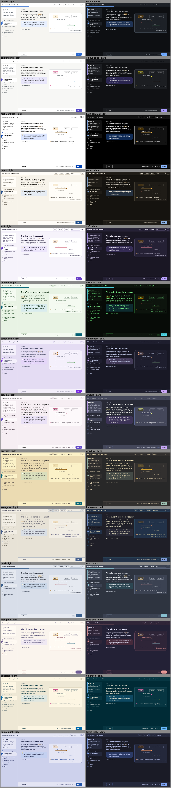

# explain-interactive

A Claude Code skill that turns an explanation you found hard to follow into a
self-contained, step-by-step interactive HTML page. Each page follows one running
example through a single shared diagram, highlights the part each step is about, and
adds a glossary, a recap and short quizzes.

- **Page types.** Besides that walkthrough, a page can be built around a decision (options
  against criteria, with a recommendation), a before/after diff, a debugging story
  (hypotheses ruled out one by one) or a concept built up layer by layer. The skill picks
  the type that fits.
- **What-if controls.** A step can carry a toggle or a slider that switches the outcome it
  shows, such as a cache hit or a miss, and the diagram parts it lights.
- **Short version.** Steps that only refresh background can be skipped with one switch.
- **Clickable diagram parts.** A part named in the glossary shows its entry on click.
- **Still confused here.** A reader stuck on a step can copy a ready-made prompt about
  that step and paste it back into Claude.

Diagrams are declared as nodes and edges and laid out by the build (sequence, chain,
layers or states), so every step shows them in the same place. Before showing you a page,
Claude checks its content and reads a screenshot of every step.

## Use

Ask for it after an explanation, e.g. "show me that as HTML", "walk me through it step
by step", or run `/explain-interactive <topic>`. The page is written to
`~/explanations/<topic>.html` (with its source, `<topic>.content.js`, next to it) and opened in your browser. Nothing is published.
`~/explanations/index.html` lists every page you have, newest first, with how far you read each one.

## What a page does

Every page gets these from the engine, whatever its content:

- **Fits the viewport**: fixed top bar, sidebar and footer; only the step area scrolls. On wide
  screens each step is two columns (text left, visual and code right); code wraps instead of being
  clipped.
- **Orientation**: every step shows "Step n of N" and slides in from the direction of travel; the
  sidebar lists every step title (current, visited, and ✓ / ? quiz marks) under the big picture,
  which also opens step 1. On phones the top bar shows the title and `n / N`, and the ☰ drawer holds
  the steps, Glossary, Show all and the theme switch.
- **Navigation**: Back / Next with a "Next: <title>" preview, ← / → keys, swipe on phones; each step
  is a browser-history entry, and `#step-N` links to a step. On the last step Next becomes
  "Finish ✓" and jumps to the finish panel (score, Start over, Review all steps, Open glossary).
- **Page-type panels**: the decision matrix, line diff, hypothesis board and layer stack, each with
  the same new / introduced / coming-later ghosting as the diagram.
- **Shared diagram**: one `DIAGRAM`, laid out from a spec or written as SVG; per-step lighting,
  ghosting of parts not yet introduced, a legend, staged reveals, arrowheads that follow the theme.
  Parts named in the glossary show their entry on click or Tab + Enter.
- **What-if controls**: a native radio group or range input, so Tab, the arrow keys and screen
  readers work as on any form; the picked outcome is announced and remembered.
- **Quizzes**: options shuffled in an order that is stable across reloads, one retry with
  option-specific hints before the answer is revealed; results show in the sidebar and the Recap.
- **Still confused here**: a box under every step that builds a prompt to paste back into Claude
  (page title, step, its text and terms, a missed check, and what the reader typed). Nothing is
  sent anywhere, and the prompt holds no file path. Hidden when printing.
- **Progress** per page (localStorage): visited steps, quiz answers, what-if picks, last step.
- **Short / full**: a Short switch skips the background steps and the Context card's setting, why
  and prereqs, renumbers what is left, and is remembered across pages. Shown only when a page has
  something to skip.
- **Glossary**: `<dfn>` tooltips (kept on-screen) that look up both the Who's who (`CAST`) and the
  glossary, plus a Glossary drawer that lists the Who's who first.
- **Index page**: every build rewrites `index.html` next to the page, listing every explainer in
  that folder with its big picture, type, step count, date and reading progress, with a filter box.
- "Show all" for skimming or printing; the sidebar and counter follow the scroll position.
- **Accessibility**: step changes, reveals and quiz explanations are announced to screen readers;
  `aria-current` marks the current step; drawers are dialogs that take focus, return it on close,
  close on Esc and block ← / → while open; ← / → scroll a wide diagram instead of changing step;
  reduced motion is respected.
- **Palettes and light/dark**: a picker offers Default, then Colour-blind safe and High contrast
  (Accessibility), then Paper, Soft and Terminal (Looks), then Catppuccin, Dracula, Gruvbox,
  Kanagawa, Nord, Rosé Pine, Solarized and Tokyo Night (Editor themes, based on those MIT-licensed
  themes), each with a light and a dark version.
  Paper, Terminal and Soft also change the font and the corners (serif and square, monospace and
  square, rounded). Light or dark follows the system setting, and the ☀ / ☾ button switches it.
  Both choices are remembered across pages, and the index page follows them. See them all in
  [Palettes](#palettes) at the end.
  Diagrams scroll sideways on phones rather than shrinking to unreadable text.

## Install

In Claude Code:

    /plugin install explain-interactive --marketplace sergicastro/skills

On Claude Code older than 2.1.275, add the marketplace first:

    /plugin marketplace add sergicastro/skills
    /plugin install explain-interactive@sergicastro-skills

## Layout

- `skills/explain-interactive/SKILL.md`: the workflow, the page types and the rules every page follows
- `skills/explain-interactive/references/`: what Claude reads only when a page needs it: the content-file format and `--check` messages (`content-file.md`), what-if controls (`whatif.md`), and one file per page type (`decision.md`, `before-after.md`, `debugging.md`, `concept.md`)
- `skills/explain-interactive/diagram-recipes.md`: how to declare the shared diagram and pick its layout
- `skills/explain-interactive/engine/`: the page shell, styles and script shared by every page (`page.html`, `engine.css`, `engine.js`), and the diagram layouts the build runs (`layout.mjs`). `engine/palettes/<id>.json` holds one palette each (colours, font, corners, borders, picker group, and a credit when it is based on someone else's theme); `palettes.mjs` loads and orders them, so adding a palette means adding one file
- `skills/explain-interactive/build.mjs`: checks a content file, inlines it into the engine and writes one offline HTML file, plus the `index.html` next to it (Node 22+, no dependencies)
- `skills/explain-interactive/shots.mjs`: renders every step of a page in headless Chrome to `step-NN.png` for review (plus `step-NN-<option>.png` per what-if option and `-phone` variants, never two with the same name), and reports what it can measure (a step taller than the screen, overflow, tiny diagram text, console errors, dialogs). `--dark` shoots the dark version and `--palette <id>` shoots one palette (an id from `engine/palettes/`, e.g. `--palette colour-blind`). With `-o` it only clears images it wrote there and refuses a folder holding other `step-*.png` files
- `skills/explain-interactive/cdp.mjs`: the small DevTools-protocol driver `shots.mjs` and the tests use (finds Chrome, Chromium or Edge on macOS, Linux and Windows or on `PATH`; times out stuck calls and answers page dialogs)
- `skills/explain-interactive/examples/`: one sample content file per page type (walkthrough, decision, before/after, debugging story, concept), and walkthroughs for each diagram layout, for what-if controls and for a wide diagram with quizzes (`dns-lookup`)
- `evals/`: skill-behaviour eval cases for `claude plugin eval`, one per page type, with a recorded baseline (see `evals/README.md`)
- `test/`: `node --test plugins/explain-interactive/test/*.test.mjs` (the browser tests need Chrome or Chromium; set `CHROME=` to pick one)

Claude writes only `~/explanations/<topic>.content.js`; the build turns it into the page. To change a page, edit its content file and rebuild:

    node skills/explain-interactive/build.mjs ~/explanations/<topic>.content.js

`build.mjs --check <file>` lists problems without writing anything. Pages made before the engine split can be recovered with `build.mjs --extract <page>.html`.

## License

MIT. See [LICENSE](../../LICENSE).

## Palettes

The same step in every palette, light and dark, in the picker's order.

