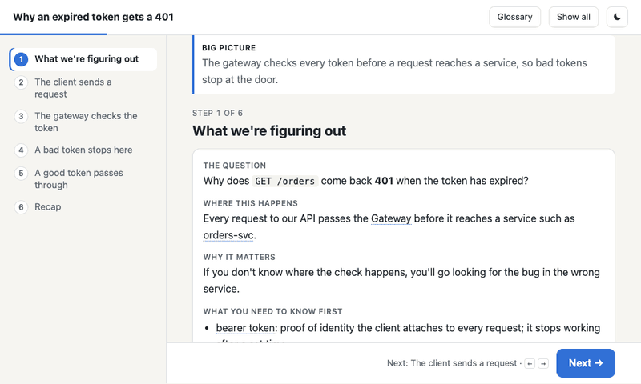

# explain-interactive

A Claude Code skill that turns an explanation you found hard to follow into a
self-contained, step-by-step interactive HTML page. Each page follows one running
example through a single shared diagram, highlights the part each step is about, and
adds a glossary, a recap and short quizzes.

## Use

Ask for it after an explanation, e.g. "show me that as HTML", "walk me through it step
by step", or run `/explain-interactive <topic>`. The page is written to
`~/explanations/<topic>.html` and opened in your browser. Nothing is published.

## Install

In Claude Code:

    /plugin install explain-interactive --marketplace sergicastro/skills

On Claude Code older than 2.1.275, add the marketplace first:

    /plugin marketplace add sergicastro/skills
    /plugin install explain-interactive@sergicastro-skills

## Layout

- `skills/explain-interactive/SKILL.md`: the workflow and the data format for each step
- `skills/explain-interactive/template.html`: the page (stepper, styles, scripts) the skill fills in
- `skills/explain-interactive/diagram-recipes.md`: patterns for the shared diagram

## License

MIT. See [LICENSE](../../LICENSE).
