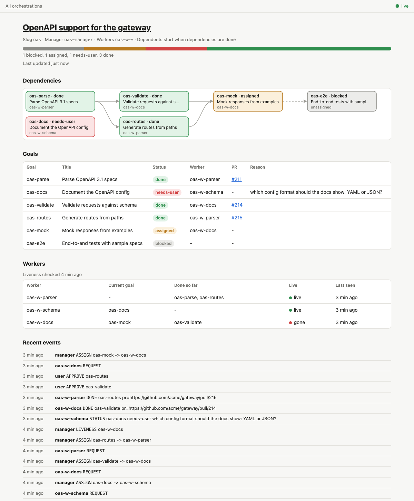
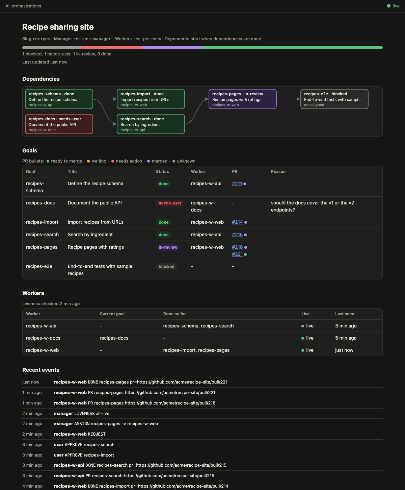
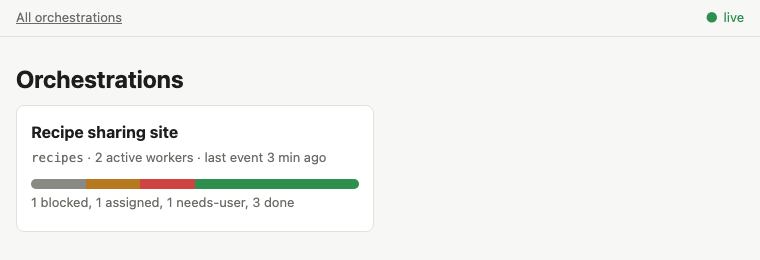

# claude-orchestrator

A pair of Claude Code skills that coordinate several user-created Claude sessions
working on related goals from one epic or task list:

- `orchestrator` — the manager session: plans goals and dependencies, keeps the
  state file, and hands out goals when workers ask for them.
- `orchestrator-worker` — a worker session: registers with the manager, asks for a
  goal when the user says so, works it, and reports back.

## Goals

- **Easy issue management with concurrent work.** One manager session keeps the
  plan, dependencies and progress for an epic, while several worker sessions take
  goals in parallel and the user reviews each one on its own.
- **Save tokens compared with one session owning every issue.** Each worker's
  context holds only its own goal and a short upstream summary, and the manager
  never sees code, diffs or logs, so no session carries the whole epic's history.

## Layout

- `skills/orchestrator/`: manager skill, plus `scripts/orch_state.py` (state helper)
- `skills/orchestrator-worker/`: worker skill
- `skills/shared/`: `protocol.md` and `github.md`, symlinked into both skills
- `tests/`: helper unit tests, skill pressure scenarios, a dry-run demo epic

## Install

```bash
ln -s ~/workspace/claude-orchestrator/skills/orchestrator ~/.agents/skills/orchestrator
ln -s ~/workspace/claude-orchestrator/skills/orchestrator-worker ~/.agents/skills/orchestrator-worker
```
To try a branch, point the symlinks at its worktree instead, then back.

## Use

1. Open a manager session (e.g. `claude -n <name>-manager`; the manager suggests a `/rename` if needed) and run `/orchestrator <epic URL, issue list or text>`.
   Review the plan and reply "go".
2. Open worker sessions named with the prefix the manager gives (`claude -n <slug>-w-<anything>`)
   and run `/orchestrator-worker <manager name>` in each.
3. In a worker, say "next" to get a goal. When it reports done, review the work and, in the manager session, type
   `approve <goal>` (or `send <goal> back`). Then say "next" in the worker again.
4. Ask the manager "status" at any time. State lives in `~/.claude-orchestrator/<slug>/`
   (`status.md` is the readable view; the manager also gives you a live page).

## Live status page

The manager starts a small local server the first time you create or resume an
orchestration, and gives you its URL (default `http://127.0.0.1:8765/`). The index lists
every orchestration; each one has a page with its dependency graph, goals, workers and
recent events, updated within a second of each change.



<details>
<summary>Dark mode and the index page</summary>





</details>

The screenshots use made-up data.

    python3 skills/orchestrator/scripts/orch_state.py serve --ensure   # start if needed
    python3 skills/orchestrator/scripts/orch_state.py serve --stop     # stop it

Without the server, open `~/.claude-orchestrator/<slug>/status.html`; it reloads every
3 seconds.

## Tests

```bash
python3 -m unittest discover -s tests -v
```

See `docs/specs/` for the design.

## License

MIT. See [LICENSE](LICENSE).
