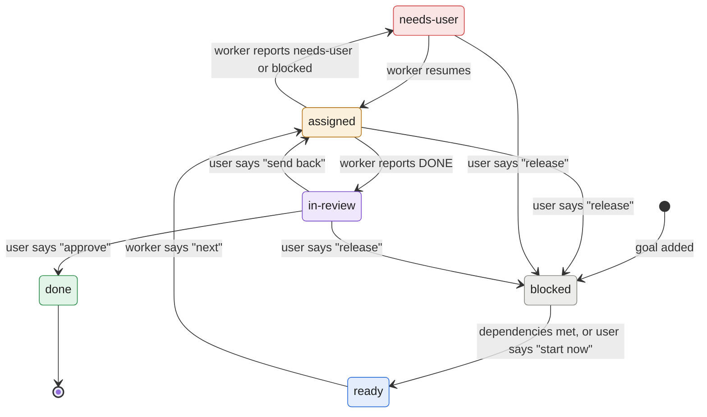
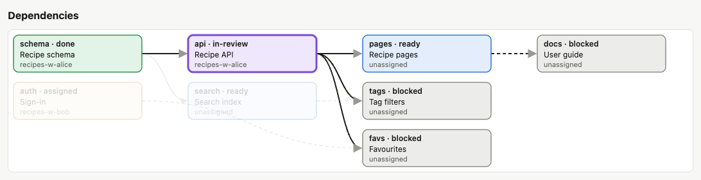

# orchestrator

A pair of Claude Code skills that coordinate several user-created Claude sessions
working on related goals from one epic or task list:

- `orchestrator` — the manager session: plans goals and dependencies, keeps the
  state file, and hands out goals when workers ask for them.
- `orchestrator-worker` — a worker session: registers with the manager, asks for a
  goal when the user says so, works it, and reports back.

The manager can also propose a change notice to the affected workers when a goal changes
or a merged goal settles a design question. It sends the notice only after the user approves;
workers acknowledge it and change course only on the user's say-so.
Workers report each PR as soon as they open it, so the status page lists a goal's PRs while it is still in progress.
GitHub issue and PR references in a goal's title or reason (`#123`, `owner/repo#123`, or a full URL) are links on the status page; a bare `#123` uses the goal's repo, or the epic's when the goal has none.
Each PR a worker opens ends with a small footer naming the worker, epic and goal, so you can tell who opened it from the PR alone.

## Goals

- **Easy issue management with concurrent work.** One manager session keeps the
  plan, dependencies and progress for an epic, while several worker sessions take
  goals in parallel and the user reviews each one on its own.
- **Save tokens compared with one session owning every issue.** Each worker's
  context holds only its own goal and a short upstream summary, and the manager
  never sees code, diffs or logs, so no session carries the whole epic's history.

## Layout

- `skills/orchestrator/`: manager skill, plus:
  - `scripts/orch_state.py`: state helper; every change to `state.json` goes through it
  - `scripts/orch_view.py`: renders `status.md`, `status.html` and the live pages
  - `scripts/orch_serve.py`: the live status server (run through `orch_state.py serve`)
  - `scripts/orch_prs.py`: PR health bullets for the live page, read with `gh`
  - `templates/`: `status.md.tmpl` and `status.html.tmpl`, used by `orch_view.py`
- `skills/orchestrator-worker/`: worker skill
- `shared/`: `protocol.md` and `github.md`, symlinked into both skills
- `tests/`: helper unit tests, skill pressure scenarios, a dry-run demo epic
- `evals/`: skill-behaviour eval cases for `claude plugin eval` (see `evals/README.md`)

## Requirements

- Python 3.9 or later; the helper scripts use only the standard library.
- macOS or Linux. The helpers lock files with `fcntl`, so they don't run on Windows
  (WSL works).
- The `gh` CLI, only for epics from GitHub and for the PR health bullets.

## Install

In Claude Code:

    /plugin install orchestrator --marketplace sergicastro/skills

On Claude Code older than 2.1.275, add the marketplace first:

    /plugin marketplace add sergicastro/skills
    /plugin install orchestrator@sergicastro-skills

To work on the skills, run Claude Code with the local copy instead:
`claude --plugin-dir plugins/orchestrator` from the repo root.

## Use

1. Open a manager session (e.g. `claude -n <name>-manager`; the manager suggests a `/rename` if needed) and run `/orchestrator <epic URL, issue list or text>`.
   Review the plan and reply "go".
2. Open worker sessions named with the prefix the manager gives (`claude -n <slug>-w-<anything>`)
   and run `/orchestrator-worker <manager name>` in each.
3. In a worker, say "next" to get a goal. When it reports done, review the work and, in the manager session, type
   `approve <goal>` (or `send <goal> back`). After an approval the manager suggests resetting
   that worker's context (`/clear`, then `/orchestrator-worker <manager name>` again), since the
   next goal arrives with everything it needs. Then say "next" in the worker again.
4. Ask the manager "status" at any time. Plans change: ask it to add, drop or edit a goal
   (title, summary, acceptance criteria, dependencies…) or to rename the epic, and the
   status page follows. State lives in `~/.claude-orchestrator/<slug>/`
   (`status.md` is the readable view; the manager also gives you a live page).
5. If a worker loses its context mid-goal (`/clear`, `/compact`, a restart), run
   `/orchestrator-worker <manager name>` in it again. The manager sees that the worker still
   holds a goal and re-sends that goal's ASSIGN after the ACK; the worker resumes when you say
   so, without a new "next". The same goes for a manager that lost its context: rename the
   session back to its recorded name if needed, then `/orchestrator <slug>`.
6. Once every goal is approved, the manager suggests a cleanup. Say "cleanup" and pick
   what to do: delete the state directory, stop the status server (if no other
   orchestration is left), and tell the workers they can end their sessions.

## Goal lifecycle



The diagram and the table use the same colors as the status page.

| Status | Meaning | Leaves it when |
| --- | --- | --- |
| ⚪&nbsp;`blocked` | Waiting on dependencies | Every dependency is `done` (or `in-review`, see below), or you say `start <goal> now` → `ready` |
| 🔵&nbsp;`ready` | Can be handed out | A worker says "next" and gets it → `assigned` |
| 🟠&nbsp;`assigned` | A worker is on it | The worker needs you → `needs-user`; it reports DONE → `in-review` |
| 🔴&nbsp;`needs-user` | The worker is waiting on you, with a reason | The worker resumes → `assigned` |
| 🟣&nbsp;`in-review` | Work is done and waits for your review | `approve <goal>` → `done`; `send <goal> back` → `assigned` (same worker) |
| 🟢&nbsp;`done` | Approved | Final |

- `release <goal>` takes a goal off its worker (gone, or you want someone else on it) from
  `assigned`, `needs-user` or `in-review`. It passes through `blocked` and goes straight on
  to `ready` if its dependencies are still met.
- By default a goal's dependents unblock only when it is `done`. Ask the manager to unblock
  on review and they start once it reaches `in-review`.
- A worker that reports "blocked" lands in `needs-user` too, with a `blocked:` reason.
- Opening a PR never changes a goal's status.
- Only `blocked` or `ready` goals can be dropped, and only when nothing depends on them.

## GitHub

For an epic from GitHub, the manager and the workers use the `gh` CLI. Each session checks
`gh auth status` before its first GitHub call; if you're not logged in, it asks you to run
`gh auth login` (and `gh auth refresh -s project` when there's a board), and keeps going with
local work until you have. On the board, a goal's issue follows its status, including after
`send back` and `release`; after `drop` the manager offers to remove the card or close the issue.
The manager comments on the epic issue and sets its status only if you agree to it in the plan
("Epic issue" line); ask it to stop or start at any time. That choice is stored as
`owned_by_manager` in the epic and can be changed with
`orch_state.py edit-epic <slug> --owned-by-manager true|false`.

## State helper

`orch_state.py` is the only thing that writes the state directory, and only the manager
runs it. Every command prints JSON on stdout. A rejected operation prints `{"error": ...}`
and exits 2; a malformed call (unknown command, missing or conflicting options) prints
`{"error": ..., "usage": ...}` and exits 2 too, and changes nothing.

- **Locking.** Each command that loads, changes and saves `state.json` holds an exclusive
  lock on `<slug>/.lock` for the whole time, so two calls can't, say, hand the same goal to
  two workers. The manager still runs its calls one at a time.
- **Free text from files.** Text that comes from a worker or the user can hold `$(…)`,
  backticks or quotes, so it never goes into a shell argument. Each text option has a
  `-file` form that takes a path, or `-` for stdin; trailing newlines are dropped:

  | Inline (short fixed text) | From a file | Commands |
  | --- | --- | --- |
  | `--notes` | `--notes-file` | `done` |
  | `--reason` | `--reason-file` | `status`, `sendback` |
  | `--summary` | `--summary-file` | `notify` |

  The manager writes the text verbatim with a quoted heredoc, then passes the file:

  ```bash
  cat > <scratchpad>/orch-text.txt <<'ORCH_EOF'
  <the text, exactly as received>
  ORCH_EOF
  orch_state.py done <slug> <worker> <goal> --notes-file <scratchpad>/orch-text.txt
  ```

  `add-goal`/`edit-goal --goal-json` and `edit-epic --title` still take their value inline.
- **Re-register.** `register` for a worker that holds an `assigned` or `needs-user` goal
  returns an `assignment` (the same JSON as `request`), which the manager re-sends as ASSIGN.

## Live status page

The manager starts a small local server the first time you create or resume an
orchestration, and gives you its URL (default `http://127.0.0.1:8765/`). The index lists
every orchestration; each one has a page with its dependency graph, goals, workers and
recent events, updated within a second of each change.

A worker reports each PR as soon as it opens it, so the PR column fills in while the goal
is still in progress, and a goal can list several PRs. A bullet after each PR link shows
its health, read from GitHub with the `gh` CLI every minute or so:

- green: ready to merge (checks pass, no review blocking it)
- yellow: waiting (a draft, checks running, or a review required)
- red: needs action (a check failed, changes requested, a merge conflict, or closed unmerged)
- purple: merged
- grey: unknown (`gh` missing, not logged in, offline, or not a GitHub PR)

Hover a bullet for the reason. Set `ORCH_PR_STATUS=off` to skip the GitHub calls; every
bullet is then grey. The server reads it at startup, so set it before the server starts or
restart it (`orch_state.py serve --stop`, then `--ensure`). `status.md` and the static `status.html` have no bullets.


Hover or tab to a goal in the dependency graph to see what it depends on and what depends
on it, all the way up and down the chain; the rest of the graph is dimmed. The highlight
stays through live updates.



<details>
<summary>Dark mode and the index page</summary>


</details>

The screenshots use made-up data.

    python3 plugins/orchestrator/skills/orchestrator/scripts/orch_state.py serve --ensure   # start if needed
    python3 plugins/orchestrator/skills/orchestrator/scripts/orch_state.py serve --stop     # stop it

Without the server, open `~/.claude-orchestrator/<slug>/status.html`; it reloads every
3 seconds.

## Tests

From `plugins/orchestrator/`:

```bash
python3 -m unittest discover -s tests -v
```

Skill-behaviour evals (these call the model and cost money; see `evals/README.md`):

```bash
claude plugin eval . --runs 1 -j 4 --no-publish
```

See `docs/specs/` for the design.

## License

MIT. See [LICENSE](../../LICENSE).
